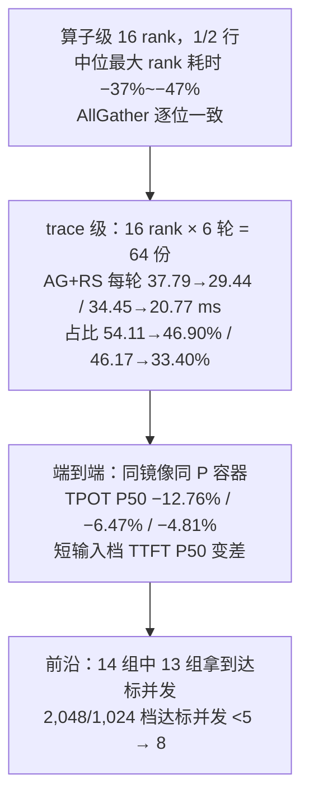

# D 端 TP16 分层通信：把 16 卡集合通信拆成「跨机配对 + 机内 8 卡」

> 归档笔记。完整图文版见 [index.html](index.html)。数字来自一次内部优化实验的验收文档（2026-11-04）；
> 标「派生」的值由本文算式给出，非实测；标「推断」的（原路径 15 轮、4 条 HCA 的映射）文档未直说。

## 0. 一句话

改的不是「少搬字节」，而是把 16 卡全组集合通信的**串行依赖链从 15 轮压到 8 轮**，
并把跨机段从「2 跳串行」变成「8 个配对并行」；因此收益只落在 TPOT，TTFT 在短输入档反而变差。

团队自己的叫法：这条路径叫「D 端分层通信」、表格行名「分层 BF16」；机制词是「同位置 rank 跨机配对」
「机内八卡集合通信」「跨机全组 AllGather／ReduceScatter」；要解的问题叫「decode 通信墙」「D 侧跨机 AR 墙」。
注意「分层」在团队文档里至少三个所指（P 端 PP 层划分 18/21/21/18、本条通信分层、分级 KV 缓存），
且 9 月有一版「机内分层 AllReduce」被判负作废 —— 与本条不是同一件事。

## 1. 部署约束：为什么这条 D 端天生跨机

| 角色 | 机器 / 卡 | 并行策略 | 关键配置 |
|---|---|---|---|
| P（prefill） | 2 机 / 16 卡 | TP4 × PP4 + CP4 | 层分配 18/21/21/18（合计 78 层）；CP 通信 FP4；8K chunk；分级 KV 缓存 |
| D（decode） | 2 机 / 16 卡 | TP16 + Attention DP4 | 全部 78 层；EP1（无专家并行，所以没有 all2all）；稀疏 KV 分池（GPU 主池 480K token、每请求热集 16K、逻辑槽**配置上限** 1.44M = 480K×3，实测逻辑池 70–74 万）；投机解码 3 步、top-k 1、draft 4 |

- D 侧 TP16 组 = 机 C 的 ranks 0–7 + 机 D 的 ranks 8–15 → 每层 MLP/MoE 的张量并行集合通信都要跨机。
- **attention 不跨机**：`attn_tp4 × attn_dp4 = TP16`，4 个 DP 组各 4 rank、每组整体落在单机内
  （每 rank 16 头；代价是 MLA KV 在组内复制 4 份）。跨机的只有 MLP/MoE 那一段 gather。

三条派生事实：

- 每 rank 一次通信搬 **12–48 KB**（1–4 行 × 6,144 × BF16 2 B）。
- 一次验证轮次携带 **≈3.2 个 token**（68.37 ms ÷ 21.41 ms = 3.19）；结构上每请求每轮有
  draft 4 + bonus 1 = **5 个位置**，实到 ≈3.2 是接受率的结果。
- 每轮这类集合通信 **≈156 次**（78 层 × 2，派生），单次平均 **242 μs**；trace 里一次「快」的调用只有 32.7–42.5 μs。

后两个数放在一起就是全文的钥匙：平均 242 μs、最快 33 μs，中间 6–7 倍不是带宽，是排队与等待。

行的来源：S = 5 × 在途并发，按 TP16 切开即每 rank 行数；S = 16–64 ↔ 1–4 行 ↔ 在途并发约 **3–13 档**。
本轮 14 组的**达标并发全部落在 1–12**，而 4 行的上沿是并发 12.8 —— 门与达标前沿同界（观察，非因果）；
扫参里 C16 的测点（5 行）在门外、走原路径，也确实都是未通过的点。

## 2. 动机

1. **占比**：`AllGather` + `ReduceScatter` 占 D 端 kernel 时间 54.11%（2K 冷前缀）／46.17%（64K／85% 共享）；
   全部通信占 GPU 活跃 57.67%／51.61%。同族文档另一处把 decode 通信记到 58% 量级。
2. **形态**：窄端 12–48 KB，但一次「快的」机内 8 卡 `AllGather` 也要 32.7–42.5 μs ——
   单次耗时里传输占不到 5%，剩下是 kernel 启动、同步与到达不齐。
3. **SLO**：2,048／1,024 冷前缀档阈值 TTFT P50 1,789 / P90 3,500 ms、TPOT P50 20.69 / P90 37.20 ms、ITL P95 70 ms；
   发布原配方在并发 5 上唯一未通过项是 **TPOT P50 = 21.41 ms**。

这条链上其实已经改过一轮：更早版本里 `attn_dp < tp_size` 时的 MLP 同步走 **gloo CPU 组**，
团队先把这一跳换成 NCCL 全组集合通信，本轮的分层是在那之上做的第二层。
所以本轮基线已是「改过一轮的 NCCL 路径」，还能再省 22%–40% —— 问题在**分解方式**，不在实现质量。

为什么不能换别的杠杆：P 端已用 CP4 + FP4 通信 + 8K chunk；D 端 attention 已留在机内；
剩余 MLP/MoE 的 TP16 路径每层各一次前向 `AllGather` + 一次反向 `ReduceScatter`；降并发等于放弃吞吐。

假设：每轮时间 ≈ 计算项 + 集合通信轮数 × 单轮固定开销。
可检验：若成立，缩小轮数只体现在通信项上，计算项纹丝不动。

## 3. 方法：两级拆解

### 3.1 形状门（来历：形状准入惯例）

```text
if dtype == BF16 and hidden_width == 6144 and 1 <= rows_per_rank <= 4
    two_level_allgather(16 ranks, shard)          // 8 轮：1 跨机 + 7 机内
    two_level_reducescatter(16 ranks, partial)    // 8 轮：7 机内 + 1 跨机
else
    original_path(16 ranks, x)                    // 镜像原路径，一行不改
```

这条门不是拍的：团队做自研通信的惯例是「先跑形状 × 原生/自研算子对照 → 只给明显获益的形状开准入 →
未获益形状保持原生 → 接入后再做服务级 A/B」（同族机内 IPC AllGather 就是 9 个形状只准入 3 个）。

### 3.2 AllGather：窄端在入口 → 跨机在前

```text
two_level_allgather(rank = (m, i), shard):            # shard: [rows_i × 6144] BF16
    # stage 1  跨机，1 轮，8 对并行
    peer = sendrecv(shard, partner=(m^1, i))          # 每对互搬 1 份 = 12–48 KB
    # stage 2  机内，7 轮，机内高速互连
    full = allgather_local(my_machine, [shard, peer]) # 8 卡 × 2 份 = 16 份
    return full                                       # [Σrows × 6144]
```

「8 对」是 8 组 rank 之间的点对点交换，**不等于 8 条独立物理链路**（见 4.2）。

### 3.3 ReduceScatter：窄端在出口 → 跨机在后

```text
two_level_reducescatter(rank = (m, i), partial):      # partial: [Σrows × 6144] 部分和
    # stage 1  机内，7 轮
    mine = reducescatter_local(my_machine, partial)   # 8 卡先归约，再收窄到 1 份
    # stage 2  跨机，1 轮，8 对并行
    peer = sendrecv(mine, partner=(m^1, i))
    return mine + peer                                # 16 卡完整归约的 1 份
```

顺序为什么相反：两级方案必须让**跨机段只搬 1 份（窄端）**。`AllGather` 的窄端在入口，`ReduceScatter` 在出口。
若 `ReduceScatter` 也先跨机，第一段就要互搬完整宽张量（16–64 行，是窄端的 16 倍），方案立刻不成立。
文档给的门是「窄端 1–4 行」而不是「宽端 16–64 行」，与这个顺序一致（推断：文档未逐行写出实现顺序）。

| 集合通信 | 阶段 1 | 阶段 2 | 轮数 | 跨机段搬多少 |
|---|---|---|---|---|
| AllGather | 跨机配对（1 轮，8 对并行） | 机内 8 卡 AllGather（7 轮） | 15 → 8 | 1 份（12–48 KB） |
| ReduceScatter | 机内 8 卡 ReduceScatter（7 轮） | 跨机配对（1 轮，8 对并行） | 15 → 8 | 1 份（12–48 KB） |

### 3.4 数值后果

- `AllGather` 逐位一致：只拼接、不做算术。
- `ReduceScatter` 不再逐位一致：两级 `(A+B)+(C+D)` vs 链式 `(((A+B)+C)+D)`，BF16 加法不满足结合律。
  实测最大 **NRMSE 0.419%**（参考：同一组 BF16 输入以 FP64 累加；同族另一批算例 0.3718%，同一套定义）。
- 因此端到端另做验收：完整输出比对、SLO、1M 长输入、D 端自动回收。

## 4. 为什么起作用

### 4.1 串行轮数 15 → 8（15 是推断值）

原路径 16 个 rank 用哪种算法（ring/tree/混合）、几轮，文档没写；下表按最常见的**环形**算 N−1 = 15。

```text
原路径 = 13 + 2k      两级 = 7 + k        （k = 跨机一跳 / 机内一轮 的耗时比）
k=1  → 8/15  = 53.3%  (−46.7%)
k=5  → 12/23 = 52.2%  (−47.8%)
k=10 → 17/33 = 51.5%  (−48.5%)
```

结果对 k 不敏感（跨机跳在两种方案里都只占少数环节），于是有一个可对账的预测：算子级耗时下降
**47% 左右**。16 rank 算子对照在 1／2 行上测到 **−37% ~ −47%**，略低于上界，差额来自多出来的那一次
stage 边界。即使原路径不是环形，结构性结论不变：轮数变少、跨机跳变少。

### 4.2 跨机环节的并发度：2 条链 → 8 对并行，但物理上只有 4 条 HCA

按 ranks 0–7 在机 C、8–15 在机 D 的放置，环上只有 2 条边跨机、其余 13 条在机内：
环形算法任何时刻只用得上 2 条机间链路，且这 2 次跨机串在链中间。
两级方案第一段是 8 对搭档同时点对点交换，一次往返结束。

但启动配置里只暴露了 **4 条机间 HCA**，最可能是 2 对 rank 共享 1 条 —— 物理链路并发度是 **2 → 4 条**，
不是 2 → 8。真正的大头是 4.1 的轮数。（推断：HCA 条数取自同族部署的启动配置；11.4 这轮的 D 启动命令未披露。）

### 4.3 字节账：几乎没省，反而多一次 stage

| 项 | 原路径 | 两级 | 怎么变 |
|---|---|---|---|
| 串行轮数 | 15 | 8 | −47%，收益主项 |
| 链上跨机环节 | 2（顺序） | 1（8 对并行） | 环节数减半；物理链路 2 → 4 条 |
| 跨机段字节（每对） | 1 份 × 2 跳 | 1 份 × 1 跳 | 份数不变，跳数减半 |
| 机内字节 | 13 份 | 14 份 | +8%，机内互连上可忽略 |
| 集合通信调用次数 | 1 | 2 | 多一次启动 + 同步，纯成本 |

最后一行是代价项，也是形状门存在的原因。门的上沿「4 行」对应并发约 12.8，与达标并发最大值 12 同档；
C16 的测点（5 行）在门外走原路径。读成「门是按准入形状筛出来的、恰好与前沿同界」比读成
「门是为扫参量身裁的」更稳。

## 5. 证据链



**可核到什么程度**：算子级只有「一个区间 + 三条数值结论」，16 rank 那张对照表的行级明细没有披露。
能对上的只有同族口径：8 rank IPC AllGather 对照用「31 次样本中位数 + 取最慢 rank」，
逐字节判据覆盖 144 个算例（含特殊 BF16 位模式）；另一批 352 个通信 rank 算例最大 NRMSE 0.3718%
（差值 L2 ÷ FP64 参考 L2），与本页 0.419% 同一套。

### 5.1 每轮 GPU 活跃时长的对账（派生）

| 场景 | 两个算子的 kernel 时间（实测） | 其余 GPU 活跃时间（派生） | 全部 GPU 活跃时间（实测） |
|---|---|---|---|
| 2K · C5 | 37.79 → 29.44（−8.35） | 30.58 → 31.86（+1.28） | 68.37 → 61.30（−7.07） |
| 64K · C5 | 34.45 → 20.77（−13.68） | 35.64 → 36.78（+1.14） | 70.09 → 57.55（−12.54） |

其余活跃时间几乎不动，通信项下降的量基本等于全部活跃时间下降的量 —— 「收益全部来自通信」的算术证据。

**两个分母不要混用**：上的「全部 GPU 活跃时间」不是占比那一栏的分母。54.11% 的分母是
「同一窗口内所有 kernel 时间之和」，「GPU 活跃」是活跃区间的并集（重叠只算一次），
所以 `37.79 ÷ 68.37 = 55.3%`，与 54.11% 差 1.2 个百分点。由占比反算：
`37.79 ÷ 54.11% = 69.84` → `29.44 ÷ 46.90% = 62.78`（Δ −7.06）、
`34.45 ÷ 46.17% = 74.62` → `20.77 ÷ 33.40% = 62.19`（Δ −12.43）—— 两个分母的降幅与活跃时间降幅
（−7.07 / −12.54）几乎相同，这是「只动了通信项」的第二条证据。

### 5.2 四条对账

| 对账项 | 结果 |
|---|---|
| 通信降幅落在哪 | 8.35 / 13.68 ms 中，7.07 / 12.54 ms 出现在总时长上（85% / 92%） |
| 非通信项是否被牵连 | +1.28 / +1.14 ms，trace 粒度上的重排 |
| TPOT 能否从 profile 推出 | 8.35 ÷ 3.19 = 2.62 ms，实测 2.74 ms，差 0.12 ms（4.4%）（仅 2K 档） |
| 占比能否单独看 | 不能：分母（全部 kernel 累计时间，由占比反算 ≈69.8 → 62.2 ms）也在降；且它 ≠「GPU 活跃」68.37 |

64K 档按同样算法应得 13.68 ÷ 3.19 = 4.29 ms，实测 TPOT P50 只动 1.49 ms —— 两组对不上。
profile 只能解释时间组成，不能做端到端外推（文档也是这么写的）。

### 5.3 口径提醒

团队 SLO 表定义的四门是「TTFT P50/P95 + TPOT P50/P90」，而 125 点表判的是 TTFT P50/**P90**
（第二个门用了更松的分位）。引用阈值一律按 125 点表口径；这不影响「TPOT P50 是唯一未通过项」，
但会让「全部通过」看起来比标准口径更强。

## 6. 代价与边界

- **TTFT**：2,048／1,024 档 P50 +65.35%（首测）／+19.96%（复测），P90 −7.04%／−17.93%；
  65,536／1,024 档 +16.65%／+1.78%；196,608／1,024 档 P50 −20.38%。
  长输入档变好（推断：排队占主导，TPOT 变快缩短排队），短输入档变差（首个 decode step 的关键路径多一次 stage 边界）。
- **唯一未达标档**：16,384／1,024。逐档表里它只在 C ≤ 2 通过（C2 总 TPS 1,823.55），汇总表却记为「未达标」——
  前沿判定与逐档单点通过不是同一套规则。
- **AllReduce 一行没动**：每 rank 6 轮内 48 次（= 8 次/轮），仍走原有 TP 归约路径。
- **残留的长 AllGather 是等待**：仍有 1.613 ms 的机内 `AllGather`（rank 0）；同一调用序号下
  rank 0–3 比 4–7 早进入约 1.58 ms，八 rank 几乎同时结束，而 rank 4–7 只花 32.7–42.5 μs。
  下一个杠杆是到达时间（负载与前序跨机配对依赖），不是算子本身。
- **会话回放收益缩水**：900 秒多轮轨迹回放（根并发 8）TPOT P50 −3.77%、总 TPS +2.26%、TTFT P50 +31.24%、
  命中率 −0.19 pp。代表点的 +8% ~ +12% 不能外推到线上。
- **门的覆盖范围**：行数 > 4（并发约 13 以上）退回原路径。要推向更高并发，门必须先重划。
- **CUDA graph**：decode 走 CUDA graph，换集合通信实现必须在图捕获下工作。同族部署踩过：某版在 decode graph
  内换实现后退化成 eager、慢约 2×，因此默认关闭。这是接入的主要工程风险。
- **数值验收不能省**：归约顺序变了，压测通过 ≠ 输出没变。

## 7. 三条最容易搞反的事

1. 分层通信省的是**轮数**，不是字节。跨机段每对仍然只搬 1 份；机内份数反而从 13 涨到 14。
2. 收益来源不是「分层」这个概念，而是「把跨机环节压成 1 跳」—— 团队 9 月的**机内**分层 AllReduce
   （省跨 socket 流量）实测无收益、路线作废，就是反例。
3. trace 里那块 1.6 ms 的 `AllGather` 是早到 rank 在**等**，不是算子慢；同一次调用里后到 rank 只花 32.7–42.5 μs。
   顺带：「8 对配对」不等于 8 条链路，物理上只有 4 条 HCA。

## 8. 自测

1. 为什么 `ReduceScatter` 的两级顺序和 `AllGather` 相反？反了会怎样？
   —— 窄端位置不同；反了第一段就要跨机搬完整宽张量（16 倍字节）。
2. 门从 1–4 行放宽到 1–32 行，最先坏的是哪一项？
   —— 跨机段字节（32 行 = 384 KB，8 倍），带宽项压过延迟项，stage 边界变成纯成本。
3. 为什么 `AllGather` 逐位一致而 `ReduceScatter` 不能？
   —— 前者只拼接，后者 BF16 求和不满足结合律。
4. 「每轮 156 次、平均 242 μs、最快 33 μs」说明什么？
   —— 单次调用耗时几乎不是传输，改轮数比改带宽有效。
5. 并发从 8 提到 32 还能吃到收益吗？
   —— 先掉出门外（32 × 5 位置 = 160 token / 16 卡 = 10 行 > 4），即使放宽门也会被带宽项吃掉。
