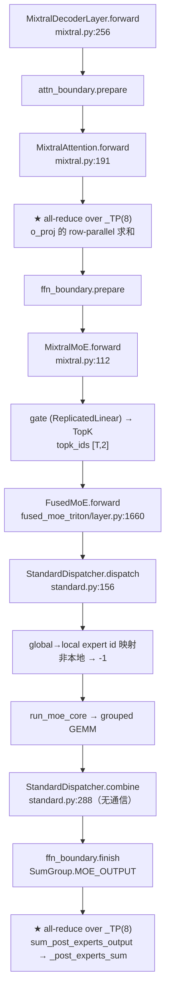

# `--tp 8 --ep 1/4/8` 的切分与通信：SGLang v0.5.23 里的 Mixtral-8x7B

> 源码基线：SGLang tag `v0.5.23`，commit `297e54fd105e974cdf401e5b4d20253a22c16f90`（2026-10-28）。
> 模型：`mistralai/Mixtral-8x7B-Instruct-v0.1`（hidden 4096、intermediate 14336、32 层、32 q 头、8 kv 头、8 experts、top-2、vocab 32000、BF16）。
> 运行口径：单机 8 卡，`pp=dp=attn_dp=attn_cp=moe_dp=1`，`moe_a2a_backend=none`（默认）。
> 本页由读源码与算术推导产出，**未做运行时实测**。

## 六条结论

1. **三种写法在默认 backend 下通信完全相同**：MoE 段只有一次 `_TP`(8) 上的 all-reduce，注意力段也只有一次 `_TP`(8) 上的 all-reduce，载荷都是 `[T, 4096]` BF16。
2. `--ep 1` 不是「专家不切」：8 个 rank 各存全部 8 个专家、每个专家只存 intermediate 的 1/8（1792 列），`w13=[8,3584,4096]`。
3. `--tp 8 --ep 4` 得到 `moe_tp=2`：每 rank 2 个专家、每个专家 intermediate 再切 2 份（7168）；EP 组 `{0,2,4,6}` / `{1,3,5,7}`，MoE-TP 组 `{0,1}` / `{2,3}` / …
4. `--ep 8` 是每 rank 一个完整专家；`_MOE_EP = _TP`，`_MOE_TP` 退化成单例；归约走 `moe_expert_parallel_all_reduce`，组还是 `_TP`。
5. 每 rank 专家参数恒为 176.16M/层（5.64B/全模型），因为 `(E/ep) × (I/moe_tp) = E×I/tp`。
6. 真正出现 all-to-all 的是 a2a backend（`deepep/mooncake/nixl/mori/flashinfer/megamoe`），它把 `ep_size` 强制改成 `tp_size`，三种写法统一收敛到 `ep=8`，MoE 段变成 dispatch + combine 两次 all-to-all。

## 参数语义

```text
# python/sglang/srt/runtime_context.py:137-157
attn_tp_size = tp_size / (attn_dp_size × attn_cp_size)
moe_tp_size  = tp_size / (ep_size × moe_dp_size)
world_size   = tp_size × pp_size
num_dp_ranks = dp_size × attn_dp_size
```

| 命令行 | ep | moe_tp | 每 rank 专家数 | 每专家 intermediate | EP 组大小 | world |
|---|---|---|---|---|---|---|
| `--tp 8 --ep 1` | 1 | 8 | 8 | 1792 | 1（单例） | 8 |
| `--tp 8 --ep 4` | 4 | 2 | 2 | 7168 | 4 | 8 |
| `--tp 8 --ep 8` | 8 | 1 | 1 | 14336 | 8 | 8 |

约束：

- `num_experts % ep == 0`（`fused_moe_triton/layer.py:414`）；`intermediate % moe_tp == 0`（`:427`）。
- `moe_dp > 1` 时要求 `ep × moe_dp == tp`（`parallel_hook.py:170-183`），且 `attn_cp != moe_dp` 只允许 `moe_dp=1`（`:189-192`）。
- a2a backend 强制 `ep = tp`（`overrides.py:1609-1619`）。
- 实际整齐布局还要求 `ep | tp`（源码只做整除，没有单独断言，属推断）。

## 并行组

| 组 | `ep=1` | `ep=4` | `ep=8` |
|---|---|---|---|
| `_TP` | `[0..7]` | `[0..7]` | `[0..7]` |
| `_MOE_EP` | 8 个单例 | `[0,2,4,6]`、`[1,3,5,7]` | `[0..7]`（复用 `_TP`） |
| `_MOE_TP` | `[0..7]`（复用 `_TP`） | `[0,1] [2,3] [4,5] [6,7]` | 8 个单例 |
| `_MOE_DP` | 8 个单例 | 8 个单例 | 8 个单例 |

```mermaid
flowchart TB
  subgraph EP1["ep=1: 每 rank 全部 8 专家的 1/8 列"]
    direction LR
    A0["R0 E0-7 · 列0/8"] --- A1["R1 E0-7 · 列1/8"] --- A2["R2 ..."] --- A3["R3 ..."] --- A4["R4 ..."] --- A5["R5 ..."] --- A6["R6 ..."] --- A7["R7 E0-7 · 列7/8"]
  end
  subgraph EP4["ep=4: 2 个专家 × 1/2 列"]
    direction LR
    B0["R0 E0,1 列0/2"] --- B2["R2 E2,3 列0/2"] --- B4["R4 E4,5 列0/2"] --- B6["R6 E6,7 列0/2"]
    B1["R1 E0,1 列1/2"] --- B3["R3 E2,3 列1/2"] --- B5["R5 E4,5 列1/2"] --- B7["R7 E6,7 列1/2"]
  end
  subgraph EP8["ep=8: 每 rank 一个完整专家"]
    direction LR
    C0["R0 E0"] --- C1["R1 E1"] --- C2["R2 E2"] --- C3["R3 E3"] --- C4["R4 E4"] --- C5["R5 E5"] --- C6["R6 E6"] --- C7["R7 E7"]
  end
```



`ep=4` 的 rank 坐标由 `tp_rank` 整除/取模得到：

```text
moe_ep_rank = tp_rank // moe_tp   # 0,0,1,1,2,2,3,3
moe_tp_rank = tp_rank %  moe_tp   # 0,1,0,1,0,1,0,1
```

## 切分逐项

| 对象 | `ep=1` | `ep=4` | `ep=8` | 随 ep 变？ |
|---|---|---|---|---|
| attention `qkv_proj` | `[768,4096]`（q4/kv1/v1 头） | 同左 | 同左 | 否 |
| attention `o_proj` | `[4096,512]` | 同左 | 同左 | 否 |
| dense MLP | Mixtral 无 | — | — | 否 |
| 专家 `w13` | `[8,3584,4096]` | `[2,14336,4096]` | `[1,28672,4096]` | **是** |
| 专家 `w2` | `[8,4096,1792]` | `[2,4096,7168]` | `[1,4096,14336]` | **是** |
| 专家参数/rank/层 | 176.16M | 176.16M | 176.16M | 否 |
| router `gate` | `[8,4096]` 全量 | 同左 | 同左 | 否 |
| embedding | `[4000,4096]` | 同左 | 同左 | 否 |
| lm_head | `[4000,4096]` + all-gather | 同左 | 同左 | 否 |
| KV cache | 1 kv 头/rank · 16 KiB/token | 同左 | 同左 | 否 |
| 激活/hidden | `[T,4096]` 全量/rank | 同左 | 同左 | 否 |
| token/专家路由 | topk 全命中 | 仅本地 2 专家命中，其余 -1 | 仅本地 1 专家命中，其余 -1 | **是**（本地掩码） |

专家参数恒等式：

```text
params_expert = (E/ep) × 3 × H × (I/moe_tp)
              = 3 × H × I × E / tp          # 当 ep × moe_tp = tp
              = 3 × 4096 × 14336 × 8 / 8 = 176,160,768
```

## 调用链



`_post_experts_sum` 的三条分支（`layers/moe/utils.py:881-897`）：

```text
ep=1: reduce_tp only  → moe_tensor_model_parallel_all_reduce → _MOE_TP = _TP
ep=4: reduce_ep + reduce_tp，can_merge 为真 → 一次 tensor_model_parallel_all_reduce → _TP
ep=8: reduce_ep only  → moe_expert_parallel_all_reduce → _MOE_EP = _TP
```

`can_merge_post_experts_all_reduce()` 的条件是 `ep > 1 && moe_tp > 1 && moe_dp == 1`（`:837-848`）。

## 通信对照

| 阶段 | 原语 | 组 | 载荷 | 次数/token step | 每 rank 字节 |
|---|---|---|---|---|---|
| input embedding | all_reduce | `_TP` | `[T,4096]` | 1 | 14.3 KiB |
| attention o_proj | all_reduce | `_TP` | `[T,4096]` | 32 | 14.3 KiB × 32 |
| MoE 输出 | all_reduce | `_TP`（三种 ep 都是） | `[T,4096]` | 32 | 14.3 KiB × 32 |
| lm_head logits | all_gather | `_TP` | `[T,4000]` → `[T,32000]` | 1 | 54.7 KiB |
| token dispatch | all_to_all | — | 默认 backend 下不存在 | 0 | 0 |
| reduce-scatter / send-recv | — | — | 本配置下不存在 | 0 | 0 |

合计：65 次 all-reduce + 1 次 all-gather，约 0.94 MiB/token/rank（Ring 公式，BF16）。

反例：若 `ep=4` 的合并被关掉，EP(4) + MoE-TP(2) 两次 AR 为 `1.5P + 1.0P = 2.5P`，合并版 `1.75P`，多 43%。

a2a 模式：`--moe-a2a-backend deepep` 把 `ep` 强制成 8，MoE 段变成 dispatch + combine 两次 all-to-all（`deepep.py:668/:723`），按 rank 计约 4 KiB/token/层，整条 forward 约 0.63 MiB/token（理想均衡估算）。

## 瓶颈

- 默认 backend：每层 2 次 all-reduce 是同步点，decode 看固定延迟、prefill 看带宽；`ep` 只改 grouped GEMM 形状，不改这两个同步点。
- `ep=8`：每 rank 只有 1 个专家，路由热点会变成 rank 间 straggler；`ep=1` 计算天然均衡。
- a2a：MoE 段载荷约降到 1/3.5，但增加 kernel 启动、handle 同步、低延迟 padding 与跨机带宽开销；收益取决于 `top_k / ep_size` 与网络。
- 真正的分水岭是 `--moe-a2a-backend`，不是 `--ep` 的数字。

## 显存账本

| 每 rank | 值 |
|---|---|
| 专家权重 | 5.637B 参数 / 11.27 GB |
| attention（qkv+o） | 167.8M / 0.34 GB |
| embedding + lm_head | 32.8M / 65.5 MB |
| router | 1.05M / 2.1 MB |
| 权重合计 | 5.84B / 11.68 GB |
| KV（32K context） | 512 MiB / 序列 |

## 汇总

| 维度 | `ep=1` | `ep=4` | `ep=8` |
|---|---|---|---|
| moe_tp / EP 组 | 8 / 8 个单例 | 2 / `{0,2,4,6}`、`{1,3,5,7}` | 1 / `_TP`(8) |
| 参数切分 | 8 专家 × 1/8 列 | 2 专家 × 1/2 列 | 1 专家整份 |
| 每 rank 专家显存 | 11.27 GB | 11.27 GB | 11.27 GB |
| MoE 段通信 | 1×AR over `_MOE_TP` | 1×AR over `_TP`（合并） | 1×AR over `_MOE_EP` |
| 通信量/token | 0.94 MiB | 0.94 MiB | 0.94 MiB |
| 计算均衡 | 最好 | 中等 | 最差（热专家集中到单卡） |
| 量化/EPLB 粒度 | 1/8 列，scale 不完整 | 2 个专家 × 1/2 列 | 整专家，适合 per-expert scale/EPLB/a2a |
| 适用场景 | 不想引入 EP 语义、要求均衡 | 增大 grouped GEMM 的 N、保留一次 AR | 大 EP 集群 + a2a 后端 |

## 常见误解

1. **`--ep 1` 表示专家不切分**：错。每 rank 有全部 8 个专家的 1/8 列；`tp=1` 时才是整份。
2. **`--tp 8 --ep 4` 是 2 份 EP 副本**：错。默认 `moe_dp=1` 时是 `moe_tp=2`，不是复制；要复制需 `--moe-data-parallel-size 2` 且配套 `attn_cp_size=2`。
3. **`ep` 越大通信越多/越少**：错。默认 backend 下三种 ep 通信完全相同；改通信的是 a2a backend。
4. **`--ep 4 --moe-a2a-backend deepep` 会得到 4 路 EP**：错，会被 `_a2a_ep_size()` 改成 8。
5. **通信一样所以 ep 没意义**：错。整专家是 a2a/EPLB/per-expert scale 的前提；`ep=1` 的列切分更均衡。选 ep 是在权重粒度、负载均衡、后端兼容性之间选。

## 源码路径

- `arg_groups/{fields/parallel.py, parallel_hook.py, overrides.py, fields/exec_.py}`
- `runtime_context.py`
- `distributed/{parallel_state.py, communication_op.py, bootstrap.py}`
- `layers/moe/fused_moe_triton/layer.py`
- `layers/moe/token_dispatcher/{standard.py, deepep.py}`
- `layers/moe/{utils.py, topk.py, ep_moe/layer.py}`
- `layers/layer_boundary/{stage.py, ops.py, exit.py}`
- `layers/{linear.py, vocab_parallel_embedding.py, logits_processor.py}`
- `models/{mixtral.py, llama.py}`
- `model_loader/loader.py`、`configs/model_config.py`
