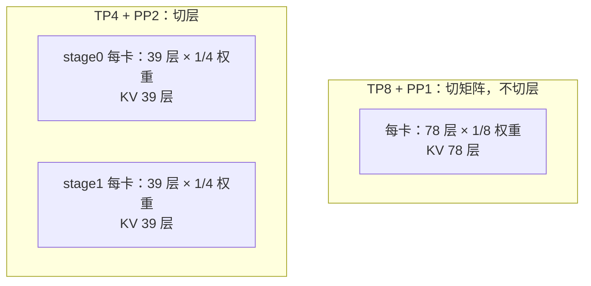
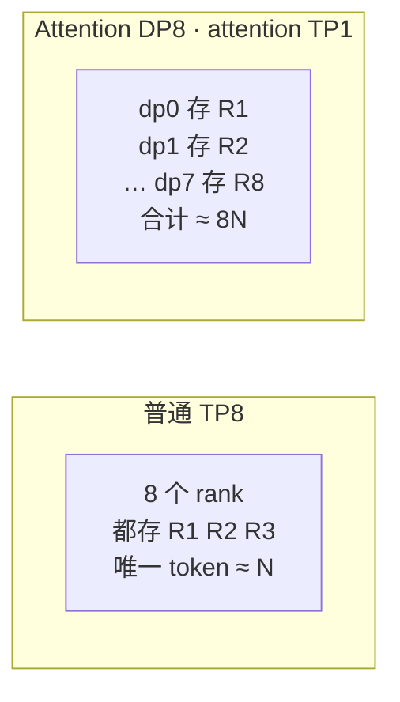

# SGLang 并行策略怎样改变 KV 池容量：分子 B 与分母 b

> 本文是 [index.html](index.html) 的文字版。结论一致，图示见网页。
> 算例口径来自知乎《SGLang 各并行策略对 KV 池容量大小影响（以 GLM 5.3 为例）》（2026-10-21），
> 原文标注实现在 `lmsysorg/sglang:v0.5.21` 镜像。

## 一、结论

1. **容量只有一个公式：单池 ≈ B / b。** B 是每卡可分给 KV 的字节，b 是每个 token 在本卡占的字节。
   任何并行策略的容量影响都能拆成"它动了 B"还是"它动了 b"；两边同时动时，
   **容量倍率 = B 的变化倍率 ÷ b 的变化倍率**。
2. **TP 只动分子。** 权重按 TP 分片释放显存，但普通 MLA 的每个 attention TP rank 仍保存**全部本地层的完整 latent KV**，
   b 不变。
3. **PP 同时动两边。** 本地层数从 78 变 39，b 直接减半；而 8 卡下权重份额没变（1/2 层数 × 1/4 分片仍是 1/8）。
   **容量翻倍的唯一来源是 KV 层数减少。**
4. **Attention DP 换的是"重复"。** TP8 时 8 个 attention rank 存同一批请求的同一份 latent；
   Attention DP8 时 8 个池各存不同请求，**唯一 token 容量从约 N 变成约 8N**，但单条请求仍受单池 N 约束。
5. **PP 的多 stage 取最小。** 代码对 `token_capacity` 做 `AllReduce(MIN)`，
   所以分层不均衡直接吃掉整个实例容量：PP4 的 19–20 层里，决定容量的是 20 层那个 stage。

## 二、两个数

```mermaid
flowchart LR
  A["每卡显存预算"] -->|减去 本地权重| B1["−"]
  B1 -->|减去 运行时 Slack<br/>(1 − mem_fraction_static)| B2["−"]
  B2 -->|减去 多模态预留 / 激活 / 通信缓冲 / graph| B3["B<br/>每卡可分给 KV 的字节"]
  C["本地缓存层数"] --> D["b<br/>每 token 字节"]
  E["每层每 token 成本<br/>主 KV + index-K"] --> D
  B3 --> F["单池容量 ≈ B / b"]
  D --> F
```

| 量 | 口径 | 由什么决定 | 主要受哪些策略影响 |
|---|---|---|---|
| B | 字节 / 卡 | 显存总预算 − 本地权重 − 运行时预留 − 激活/通信/graph 工作区 | TP、PP、EP（分片释放 B）；Attention DP、CP（复制权重或放大工作区吃掉 B） |
| b | 字节 / token / 卡 | 本地缓存层数 × 每层每 token 成本 | PP（层数变少）、CP 的 DSA 层分片、DCP（位置分片） |

## 三、分子 B：测出来的，不是算出来的

SGLang 在加载模型后测一次空闲显存，权重占用已体现在结果里：

```python
# KVCacheConfigurator._profile_available_bytes · mem_cache/kv_cache_configurator.py · L2186–L2208
gc.collect()
available_gpu_memory = get_available_gpu_memory(...)
slack_gb = pre_model_load_memory * (1 - get_schedule().mem_fraction_static)
mm_reservation_gb = mm_runtime_reservation_gb(...)
rest_memory = available_gpu_memory - slack_gb - mm_reservation_gb
```

```python
# DefaultPoolConfigurator.calculate_pool_sizes · model_executor/pool_configurator.py · L552–L562
max_total_num_tokens = available_bytes // self._cell_size
max_total_num_tokens = max_total_num_tokens // page_size * page_size
```

注意 `--max-total-tokens` 会盖住测算值：扩大理论预算后容量仍可能停在这个上限上，
所以分析容量要同时看**测算值**和**配置值**。

## 四、分母 b：GLM 5.3 的一个 token 存什么

配置：78 层、`kv_lora_rank=512`、`qk_rope_head_dim=64`、`index_head_dim=128`。

```python
# GlmMoeDsaForCausalLM · models/glm4_moe.py · L1437–L1438
class GlmMoeDsaForCausalLM(DeepseekV2ForCausalLM):
```

scaled FP8 布局下，每层每 token：

| 组成 | 计算 | 字节 |
|---|---|---|
| latent | 512 × 1 B | 512 B |
| scale | (512 / 128) × 4 B | 16 B |
| RoPE | 64 × 2 B | 128 B |
| **主 KV 合计** | | **656 B** |
| index-K | 128 × 1 B | 128 B |
| index scale | 1 × 4 B | 4 B |
| **合计** | | **788 B** |

```
78 层：78 × 788 = 61,464 B ≈ 60.02 KiB / token / 卡
39 层：39 × 788 = 30,732 B ≈ 30.01 KiB / token / 卡
20 层：20 × 788 = 15,760 B ≈ 15.39 KiB / token / 卡   ← PP4 最重 stage
```

DSA 的 top-k 减少的是 attention 的**访问与计算量**，主 KV 仍保存完整历史；
index-K 只在部分层分配时才省。

## 五、TP 与 PP



**TP 切矩阵**（`ColumnParallelLinear` / `RowParallelLinear`，`layers/linear.py`），每卡拿到矩阵一片，
释放显存，但层数不变 → **b 不变**。

**PP 切层**（`make_layers` + `PPMissingLayer`，`utils/common.py`；`resolve_layer_indices`，`layer_setup.py`），
本 stage 之外的层被占位替换 → **b 随本地层数减小**。

固定 8 卡、78 层、路由专家权重均匀分配：

| 配置 | 每卡层数 | 每卡专家权重份额 | 每 token KV 成本 | 固定 B 时理论容量 |
|---|---|---|---|---|
| TP8＋PP1 | 78 | 总量约 1/8 | 约 61,464 B | 1 倍 |
| TP4＋PP2 | 39 | 1/2 层 × 1/4 分片，约 1/8 | 约 30,732 B | 约 2 倍 |
| TP2＋PP4 | 19–20 | 1/4 层 × 1/2 分片，约 1/8 | 最重 stage 15,760 B | 约 3.9 倍 |

**PP 取最穷的 stage**：

```python
# KVCacheConfigurator._apply_token_constraints · L2280–L2288
torch.distributed.all_reduce(tensor, op=torch.distributed.ReduceOp.MIN, group=...)
token_capacity = tensor.item()
```

所以 78/20 = 3.9，而不是 78/19.5 = 4。

## 六、CP

1. **普通池不省缓存**：CP 过程重建完整 latent 历史，b 不变。
2. **但 CP 吃掉分子**：它挤掉 attention TP ——

```python
# derive_attention_widths · runtime_context.py · L73–L78
attn_dp_size = dp_size if enable_dp_attention else 1
return attn_dp_size, tp_size // attn_dp_size // attn_cp_size
```

TP4＋CP4 → attention TP1，注意力投影复制到 4 个 CP rank，B 下降。

3. **DSA 层分片才动分母**：`--enable-dsa-cache-layer-split`

```python
# get_glm_dsa_layer_split_effective_num_layers · layers/cp/utils.py · L85–L91
owned_layers_upper_bound = (num_layers + shard_size - 1) // shard_size
return max(1, owned_layers_upper_bound + 1)
```

78 层、CP4 → 20 个所属层 + 1 个远程 scratch = **21 个有效层**。
硬条件：PD prefill、interleave CP、Mooncake 且 **PP1**；`pp_size > 1` 直接抛错。

## 七、DCP

按位置分片：rank0 拿 token 0/4/8…，rank1 拿 1/5/9…，以此类推。

```python
# KVCacheConfigurator.logical_token_capacity · L319–L328
return max_total_num_tokens * get_parallel().attn_dcp_size // self.loc_space_scale
```

逻辑 token 容量 = 本地物理行数 ÷ `loc_space_scale` × DCP 组宽。分母侧主 KV 缩为 1/c。
**本页 GLM 5.3 算例走 DCP1**；上面是通用 target MLA 的映射。

## 八、EP

```python
# FusedMoE.init · layers/moe/fused_moe_triton/layer.py · L397–L408
self._num_local_routed = self._num_global_routed // storage_ep_size
self.intermediate_size_per_partition = intermediate_size // self.moe_tp_size
```

本地路由专家权重 ≈ 本 stage 权重 / (EP × MoE_TP)。固定 TP 组宽且 `MoE_DP=1` 时
`MoE_TP = TP / EP`，所以 `EP × MoE_TP = TP` 恒定 —— **EP 改的是怎么存，不是存多少**。

## 九、DP 与 Attention DP



| 问题 | 普通 TP8 | Attention DP8 |
|---|---|---|
| 单条请求能放多长 | 约 N（全机共用） | 约 N（受所属池约束） |
| 整机同时承载的唯一 token | ≈ N | ≈ 8N |
| 每卡权重占用 | 注意力 1/8 分片 | 注意力权重复制更多 → B 下降 |

## 十、策略矩阵

| 策略 | 分子 B | 分母 b | 单池容量 | 合计容量 |
|---|---|---|---|---|
| TP ↑ | 增大 | 相等 | 增大 | 增大 |
| PP ↑ | 增大 | 减小 | 增大更多 | 取各 stage 最小 |
| CP ↑ | 减小 | 普通池相等；层分片时减小 | 普通池减小 | 分情况 |
| DCP ↑ | 近似相等；Q 复制时减小 | 减小 | 近似 c 倍 | 分情况 |
| EP ↑ | 固定 TP 组宽时近似相等 | 相等 | 近似相等 | 近似相等 |
| 普通 DP ↑ | 加 GPU 相等；固定卡数减小 | 相等 | 不变或减小 | d × 单池 |
| Attention DP ↑ | 减小 | 相等 | 减小 | D × 单池 |
| PD 分离 | 各角色不变 | 各角色不变 | 同角色相等 | P 侧随副本增加 |

读法：① B↑ 且 b 相等 → 按 B 倍率；② B 相等且 b↓ → 按 1/b 倍率；
③ 两边都动 → B 倍率 ÷ b 倍率；④ 协同实例取最小，独立池求和。

## 十一、常见误解

- **「TP 越大 KV 越大，因为权重少了」** —— 对一半。B 确实变大，但 b 不变。
- **「PP 只是把权重摊开」** —— PP 把**层**摊开，连 KV 层数一起少了；8 卡翻倍靠的是 78→39 层。
- **「Attention DP 让单条请求放更多」** —— 不能，它提升的是整机同时承载量。
- **「DSA 用 top-k 所以 KV 变小」** —— top-k 减少的是访问与计算量，主 KV 仍存完整历史。

## 十二、附：可拖动计算器

网页第十一节有一个计算器，输入总卡数 / TP / PP / CP / Attention DP / 每卡 KV 预算，
实时算出本地层数、b、派生 attention TP、单池容量与合计容量。默认 8 卡 / TP8 / PP1 / 20 GiB：
78 层 × 788 B = 61,464 B/token，20 GiB ÷ 60.0 KiB ≈ 349.4k token。

计算器**只算 b 那一边**：B 由你直接输入，不替你估权重、激活、通信缓冲与图捕获。

## 未做的验证

本页没有跑运行时实测。61,464 / 30,732 / 15,760 B 与 1× / 2× / 3.9× 都是从 788 B 布局与层数算出来的，
不是测出来的。B 的绝对值依赖权重、激活、通信缓冲与图捕获，需要实测。
