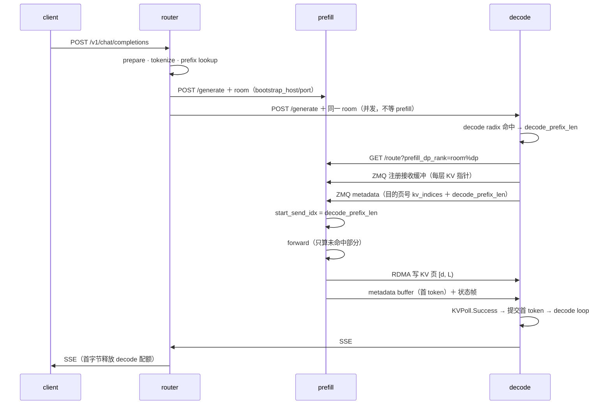

# SGLang Router 的调度与 PD 请求生命周期

> 源码基准：`sgl-project/sglang` `main` @ `f534dbae`（2026-11-17）。
> 读取范围：`sgl-router/src`（116 个 `.rs`）、`python/sglang/srt/disaggregation`、`managers`、`mem_cache`、`arg_groups/fields/disagg.py`。
> 未编译、未运行；所有默认值取自源码字面内容。标 **推断** 的段落是根据调用链推出、源码里没有直接断言的。

## 术语

- `router` = `sgl-router` 进程，机群级入口，一个进程服务一个模型。
- `worker` / engine = 一个 SGLang 实例（HTTP 端口 + 内部 Scheduler）。
- `prefill` / `decode` = worker 角色，启动时由 `--disaggregation-mode` 固定。
- `room`（`bootstrap_room`）= router 生成的正整数，prefill 与 decode 之间唯一的关联键。
- `bootstrap` 有两个含义：PD 的 KV 引导握手（`bootstrap_host/port/room`、`/route`），以及 router 之间的 **peer bootstrap**（radix tree 快照同步）。本文分别写作 PD bootstrap 与 peer bootstrap。

## 一、五条结论

1. Router 是控制面：选 worker、生成 `room`、把同一份请求体同时发给 prefill 与 decode；KV 由 prefill 直连 decode，router 不参与（`src/server/routes/chat/forward.rs:216-244`）。
2. 默认策略不是 cache_aware：legacy 默认 `round_robin`，reorg 默认 `power_of_two`；cache_aware 必须显式选，并先有前缀信号（`src/config/cli.rs:250-258`、`src/config/cli.rs:884-890`）。
3. 选路是一条阶梯：cache winner → 全局会话亲和 → 按 bucket 的准入 → capacity fallback → 503（`src/policies/selection.rs:210-330`）。
4. PD 下 prefill 与 decode 是两次独立 dispatch，几乎同时发出；客户端拿 decode 的流，prefill 失败则归因给 prefill（`forward.rs:890-950`）。
5. 三种命中情况的差别不在 router 的配对逻辑，而在三处数字：prefill 算多少（`L−p`）、decode 声明多少（`d`）、传多少页（`L−d`）。

## 二、角色与边界

| 组件 | 持有 | 不持有 |
|---|---|---|
| sgl-router | worker 注册表、in-flight 计数、前缀索引（`block_hash → (url, dp_rank, tier)`）、会话绑定、断路器、负载快照 | KV 张量、显存地址、block 的 token ids（LoRA 路径例外）、每块真实 token 数 |
| prefill worker | 自己的 radix cache 与 KV pool、bootstrap HTTP server（8998）、ZMQ 端点、每 room 的 sender | decode 的页表；只知道 decode 给的目的地址与 `decode_prefix_len` |
| decode worker | 自己的 KV pool 与 `req_to_token_pool`、可选 radix cache、receiver 状态机、输出 token | prefill 上前缀是"算过"还是"缓存里" |
| KV indexer（可选） | `block hash → token 数 + (worker, tier)`、per-worker 规格、命中计数 | KV 本身；软状态，无持久化 |

一句话：**router 认识"哪个 worker 可能有这段前缀"，prefill 认识"KV 在哪几页"，decode 认识"我要放到哪几页"。**

## 三、调度链

```text
POST /v1/chat/completions
└─ chat::route                                        src/server/routes/chat.rs:190
   └─ prepare → prepare_now                           :275
      ├─ parse_routing_fields / PreparedRequest::openai
      ├─ request_tokens_for(…)                        policies/mod.rs:52
      │    └─ 仅当 should_tokenize_request 为真        preparation.rs:1203
      └─ ModelRouting::lookup                         chat.rs:371
   └─ ModelRouting::dispatch                          chat.rs:398
      │  for attempt in 0..--retry-max-attempts       （默认 1，即不重试）
      ├─ sleep(backoff(attempt))                      chat.rs:404
      ├─ select_workers                               chat.rs:442
      │  ├─ PdPoolResolver::prefill_candidates        policies/registry.rs:173
      │  ├─ lookup_prefix_matches                     chat.rs:691
      │  ├─ capture_load_snapshot                     chat.rs:571
      │  ├─ prefills_with_decode                      chat.rs:520   ← 版本组对齐
      │  ├─ pick_prefill_worker → select_prefill_worker  selection.rs:137
      │  └─ pick_decode_worker  → select_decode_peer     selection.rs:779
      └─ forward_request → dispatch                   forward.rs:61 / :167
         ├─ room = generate_room_id[_for_rank]        preparation.rs:1264
         ├─ spawn_prefill_request(prefill, room)      forward.rs:812
         └─ transport.send(decode)                    ← 客户端响应来自这条腿
            └─ forward_pd(prefill_task, decode)       forward.rs:905
```

两个细节：

- **tokenize 可选**：只在策略需要 token（cache_aware 恒真）、`--dp-aware`、或 bucket 按长度分桶时做（`preparation.rs:1203-1209`）。
- **`--no-tokenizer` 让 cache_aware 静默退化**：没有 token 就没有 block hash，阶梯直接走 load 兜底（**推断**，由 `chat.rs:691-729` 的 `zip(tokens)` 分支推出）。

### PD 派发时序



`forward_pd` 的语义（`forward.rs:905-950`）：decode 先返回 → 直接给客户端；prefill 先失败 → 返回 prefill 的错误并归因；需要 input logprobs 或开了 `--pd-stream-after-prefill` 时，decode 的响应先被 hold 住，等 prefill 完成再合并。

## 四、策略矩阵

| policy | 读什么 | 怎么排 | 何时被选 |
|---|---|---|---|
| round_robin | 无 | 轮转 | legacy 默认；sticky 兜底 |
| random | 无 | 均匀随机 | 显式；压测对照 |
| power_of_two | 负载快照 | 抽 2 个取较轻 | reorg 默认；cache_aware 兜底；decode 默认 |
| load_based | 负载快照 | 全池最小 | 显式 |
| cache_aware | 前缀命中＋负载 | 未命中 token 最少 | 显式；PD 下只作用于 prefill/plain |
| session_aware | 会话绑定＋负载 | 绑定优先 | 多轮对话 |
| sticky | 路由头 key | key→worker | 按业务 key 固定 |
| score_policy / fused_score | `--fuse` 加权项 | 加权和 | 混合打分 |

decode 侧只有 `power_of_two`（默认）与 `legacy_host_affinity`（`src/config/types.rs:151-159`）。

### prefill 选择阶梯（`selection.rs:210-330`）

1. **cache winner**：cache_aware 专属；候选截断 → 队头闸门 → 容量准入 → 未命中近似并列时按压力决胜。
2. **global affinity**：session_aware 且非 bucket 模式时，在全局池探一次绑定。
3. **per-domain 准入**：按 bucket 切域，每域提案后过 `resolve_prefill`（`num_running+1 ≤ max_running`、`num_total_tokens+input ≤ max_total`）。
4. **capacity fallback**：所有域严格准入都失败后整条再来一遍，允许容量兜底。
5. **失败** → `PolicySelectionFailed` / `NoPrefillWorkersAvailable` → 503（`error.rs:218-222`）。

decode 是同样的两轮结构（`selection.rs:779-838`），且**没有负载快照就直接返回 None**，不盲选。

### 负载比较（`engine_ranking.rs:15-59`）

```text
prefill：estimated_prefill_queue_ms ↑
         → num_waiting_uncached_tokens ↑
         → num_waiting_reqs ↑
         → num_running_reqs ↑
         → router 本地 in-flight ↑
decode ：num_waiting_reqs ↑ → num_running_reqs ↑ → KV 占用率 ↑
```

逐字段字典序，第一个不等的字段定胜负。数据来自引擎的 ZMQ PUB `LoadStat`（wire：`[b"load", seq, msgpack]`），超过 5 秒视为过期，退回 router 自算 in-flight（`engine_reported_load.rs:294-297`、`load_publisher.py:1-40`）。

## 五、缓存感知：三份信号、四道闸门

前缀来源二选一（`cli.rs:884-890`）：

- **外部 KV indexer**（gRPC `MatchExternalKvPrefix`）：`worker_address` 必须与 router 注册的 URL 逐字节一致（`policies/cache_aware.rs:45-48`）；不可达/超时/过载 → 降级 min-load（`chat.rs:754-774`）。
- **进程内 radix tree**：引擎开 `--kv-events-config`，router 从 `/server_info` 发现并订阅；事件只有 `BlockStored` / `BlockRemoved` / `AllBlocksCleared`（`wire.rs:49-58`）；节点存 `(block_hash, parent, workers{(url,dp_rank): tiers})`，不存 token ids、不存 KV（`tree.rs:489-507`）。

块哈希：`SHA256(父块完整 32 字节摘要 ‖ 本块 token 的 4 字节小端)`，截前 8 字节成 `i64`（`hash.rs:137-163`）。三个输入决定"算不算同一段前缀"：`block_size`（来自 worker `page_size`，first-wins）、`cache_salt`（链首种子）、`lora_name`（二次 keying）。`CacheNamespace` 来自 body，一个请求内多个值不一致即 `ambiguous`，返回空哈希——宁可 miss（`hash.rs:64-67`）。

换算（`policies/cache_aware.rs:202-217`）：

```text
matched_tokens  = input_tokens × matched_prefix_blocks / query_blocks
uncached_tokens = input_tokens − matched_tokens
```

没有 `blocks × block_size` 的乘法：router 不知道每块真实 token 数，只能按查询块数等比折算。

四道闸门（顺序不可换）：

| 闸门 | 判据 | 默认 |
|---|---|---|
| 命中门限 | `matched ≥ 1024` 且（若设）`matched/input ≥ ratio` | 1024 tokens |
| 候选截断 | `min(N, 32, max(8, ceil(0.05×N)))` | 8 / 0.05 / 32 |
| 队头闸门 | `num_waiting_reqs < --worker-queue-limit`，无样本放行 | 未设（关闭） |
| 容量准入 | `running+1 ≤ max_running` 且 `used+input ≤ max_total` | 由引擎上报决定 |

软机制：**切换余量** `--cache-switch-margin-tokens`（默认 1024）只在未命中差超过它时才允许负载翻盘（`admission.rs:607-648`）；**压力守卫**（1024 tokens / 1.5×）在近似并列集合内把明显更受压的候选排后（`admission.rs:659-692`）；**饱和钉住**：队头闸门拒掉全部候选且全机群无人低于 `--saturation-queue-floor` 时，保留前缀所有者（`admission.rs:283-345`）。

## 六、PD 配对

### room 的生成（`preparation.rs:1264-1272`）

```rust
pub(super) fn generate_room_id() -> u64 {
    rand::random::<u64>() & (i64::MAX as u64)
}
pub(super) fn generate_room_id_for_rank(rank: u32, dp_ranks: u32) -> u64 {
    (generate_room_id() >> 1) / dp_ranks * dp_ranks + u64::from(rank)
}
```

decode 默认用 `room % prefill_dp_size` 推断去哪个 prefill DP rank 取 KV（`decode.py:1197-1199`）；router 若替 prefill 选了 rank，就必须让取模结果等于它，否则 decode 查错 rank。显式通道是 `disagg_prefill_dp_rank`（`forward.rs:759-778`）。

### 九步握手

| 步骤 | 谁发起 | 协议 | 携带 |
|---|---|---|---|
| ① 拓扑注册 | prefill（启动期每 rank） | HTTP `PUT /route` | rank 四元组、`rank_ip:rank_port`、`page_size`、dtype、layout |
| ② 请求到达 | router | HTTP ×2 | `bootstrap_host/port/room`（+ 可选 `disagg_prefill_dp_rank`） |
| ③ 查对端地址 | decode | HTTP `GET /route` | 返回 `rank_ip:rank_port` |
| ④ 注册接收缓冲 | decode → prefill | ZMQ | 每层 KV 指针、aux/state 指针、`dst_kv_item_len`、层 id |
| ⑤ 发布目的页 | decode → prefill | ZMQ | `room`、`kv_indices`、`aux_index`、`decode_prefix_len` |
| ⑥ 定稿起点 | prefill | 本地 | `start_send_idx = d`；`num_pages = ceil((L−d)/P)` |
| ⑦ 传 KV | prefill → decode | RDMA | 按层/按页/按 chunk 批量写 |
| ⑧ 交首 token | prefill → decode | RDMA metadata buffer | `output_ids[0]`、logprobs、`bootstrap_room` |
| ⑨ 完成确认 | prefill → decode | ZMQ 状态帧 | `[room, status, prefill_rank]` |

④⑤ 与 ⑦ 方向相反：decode 先说"往哪写"，prefill 再推数据。bootstrap 本质是**地址交换**，不是礼节性握手。

### 完成判定（三件事都到齐）

1. 所有目标 prefill rank 的状态帧到齐（按 `prefill_unique_rank` 去重计数，`conn.py:1053-1076`）；
2. metadata buffer 里确实写进了本 room 的首 token（读到 `bootstrap_room == 0` 仍算 `Transferring`，`utils.py:339-354`）；
3. 页数据收齐。

第 2 条防的是"状态帧比数据先到"的竞态，同时防 room 复用串号（不匹配直接 abort，`decode.py:3420-3466`）。

### 传输

- 不在 scheduler 线程：scheduler 只入队，prefill 每 TP rank 有 4 个队列（`SGLANG_DISAGGREGATION_QUEUE_SIZE`），每队列一个 worker 线程 + 线程池（`mooncake/conn.py:354-402`）。
- 分片确定性：`Σ(目的 session 端口) % 队列数`（`:3440-3450`）。
- 三层并行：rank 间 / 层间（`executor.submit`，`:1370-1379`）/ 页间（连续页合并，`:1207-1209`）。
- 与计算先后：默认算完再传；缓存命中部分可提前发（`maybe_send_cached_prefix_chunk`，`prefill.py:1627-1666`）。

### 失败与超时

| 失败面 | 检测 | 默认 | 后果 |
|---|---|---|---|
| prefill 等不到目的地 | `_check_bootstrap_timeout` | 300 s | Failed，abort(500) |
| decode 等不到完成 | `_check_waiting_timeout` | 300 s | Failed + abort 通知 |
| prefill 节点消失 | 心跳 `GET /health` | 5 s × 2 | 该地址所有未完成 room Failed |
| RDMA 非 0 | worker 检查返回值 | — | `conclude_failure`，状态帧 Failed |
| 客户端断开 | decode abort | — | `ABORT` 帧；deferred 模式等 drain 完再 ACK |

> peer bootstrap 是另一件事：新副本从同级副本拉 radix tree 快照，`--kv-peer-selector` 开启，预算 10 分钟，失败可让 `/readyz` 保持 503。

## 七、三种命中情况

记号：

```text
L  prompt token 数
P  page_size（= router 的 block_size）
p  prefill 侧 radix 命中长度（page 对齐，0 ≤ p ≤ L）
d  decode_prefix_len（默认 0；需 --disaggregation-decode-enable-radix-cache）

计算量 = L − p
传输量 = L − d
router 可见的是 p；d 由 decode 自己算，router 从不知道
```

### A. 完全未命中（p=0, d=0）

1. router：`PrefixOutcome::Empty` → cache 候选为空 → 退回 P2；选 prefill/decode，生成 room。
2. prefill：match=0，forward 全量 `L`。
3. bootstrap：`d=0` → `start_send_idx=0`，`num_pages=ceil(L/P)`（`prefill.py:536-549`）。
4. 传输：`[0, L)` 全部页。
5. 完成：prefill 采样首 token → 状态帧 → decode 计数到齐 → Success。

开销：算 `L`、传 `L`；decode 等 `max(自己排队, prefill 算完+传完)`。

### B. 部分命中（0<p<L, d=0）

1. router：`matched_blocks > 0`，折算 token；过 1024 门限成为候选；队列满则可能换 owner 或触发饱和钉住。
2. prefill：`prefix_len=p`，只算 `L−p`。
3. bootstrap：同 A（`d=0`）。
4. **传输量不变**：`[0,p)` 虽不用算，但仍要从 prefill cache 读出并发送。early-send 可让这段与 forward 重叠。
5. 完成：同 A。

收益全在 `L−p` 上；加速比大致 `(L+传输)/(L−p+传输)`——前缀越长、传输占比越高，边际收益越小。

### C. 全部命中（p≈L, d=0）

1. router：命中比≈1，几乎必然选原 owner；唯一有价值的判断是"还收不收得下"。
2. prefill：`extend` 只剩最后一页；仍要 forward 一次才能采样首 token（`prefill.py:1197`）。
3. bootstrap：**仍然要握手**，协议没有"decode 自行完成"的分支。
4. 传输：`[0,L)` 仍要发（d=0）；只有 `d=L` 时区间才为空：`end_idx < start_send_idx` 直接 return，相等时也是零页（`prefill.py:1718-1723`）。
5. 完成：同 A。

> "全部命中" ≠ "prefill 不参与"。它只让 forward 退化成最后一页；bootstrap、首 token 采样、传输一件没少。

## 八、三种情况对比

| 维度 | A 全未命中 | B 部分命中 | C 全部命中 |
|---|---|---|---|
| 是否触发 prefill | 是，算 L | 是，算 L−p | 是，只算最后一页（采样所需） |
| 是否需要 bootstrap | 需要 | 需要 | 仍需要（d=L 时仍握手、仍有状态帧，只是 0 页） |
| KV 传输量 | L | L（不变） | L（不变） |
| 传输内容 | 全层 KV + aux | `[0,p)` 来自 cache，`[p,L)` 来自本次 forward | 几乎全部来自 cache |
| Router 决策差异 | 候选空 → P2/轮转 | 按未命中排序；可能被队列/压力守卫改判 | 候选唯一；决策退化为容量判断 |
| 延迟主要来源 | prefill 计算 ≫ 传输 | 计算 `(L−p)/L` + 传输 | 传输 + 握手往返 |
| 资源开销 | prefill GPU 满载，decode 空等 | prefill 部分负载 | prefill 近空闲，瓶颈转到网络与 decode 准入 |

工程结论：p 很大时，继续优化 cache-aware 的收益已经很小，剩余时间几乎全在搬 KV。要么开 decode 侧 radix cache 让 d>0，要么缩短 L，要么提高传输带宽/并行度。

## 九、超时、重试、健康、背压

| 机制 | 默认 | 行为 |
|---|---|---|
| 重试次数 | **1（不重试）** | 含首次；注释说 3 是典型值，但默认关闭 |
| 退避 | 50 ms ×2 上限 2000 ms，半区间 jitter | 不超 stale 预算剩余 |
| 可重试 | 仅"尚无响应到达客户端"：传输错误、5xx、429/503 | 4xx（除 429）与 2xx 不重试 |
| 重试排除 | 给出响应的 worker；PD 下有责 prefill；caller 自带 rid 时两侧 | `forward.rs:371-379` |
| 请求总寿命 | 600 s | 504 `stale_request_expired`；流已开始只断流 |
| 上游超时 | 300 s | 非流式整响应；流式=响应头（首 token，含排队） |
| 流空闲 | 180 s | chunk 间最大静默 |
| 断路器 | 3 次失败 / 30 s 冷却 | 打开后剔除；冷却放一个探针；503/429 视为背压不计失败 |
| 健康检查 | — | **无主动探测**；`/healthz` 恒 200，`/readyz` 看池 + peer bootstrap |
| 注册表 | — | 全员熔断时 fail-open 回全池 |
| decode 闸门 | 未设 | `--decode-dispatch-limit N` 每 prefill rank 最多 N 个首 token 前的请求，超出阻塞 |

背压出口只有 503 与 504。router **不生成 429**（`ApiError` 无该变体）；引擎的 429/503 原样转发并归入 `Backpressure`，不打开熔断器、不清失败连击（`circuit_breaker.rs:207-238`）。

## 十、四个误解

1. **"router 转发 KV"**：不会。只传 room 与 bootstrap 地址，KV 由 prefill 直连 decode。
2. **"cache_aware 看 GPU 里的 radix tree"**：看的是块哈希的持有关系（indexer 或 router 自己的树），router 没有 KV，也不知道块的 token 内容。
3. **"全命中就不用 prefill / 不用 bootstrap"**：都要。prefill 至少要 forward 一次来采样首 token。
4. **"router 会做健康探测"**：这个版本没有。`src/health/` 下只有断路器，没有 `--health-*` 参数。

## 附：本文用到的关键源码

- 路由入口与派发：`sgl-router/src/server/routes/chat.rs`、`chat/forward.rs`、`chat/preparation.rs`
- 选择阶梯与准入：`sgl-router/src/policies/selection.rs`、`admission.rs`、`power_of_two.rs`、`cache_aware.rs`、`decode.rs`
- 前缀索引：`sgl-router/src/state/kv_events/{tree,hash,prefix_provider,index,wire}.rs`、`sgl-kv-indexer/proto/kv_indexer.proto`
- 负载：`sgl-router/src/state/load_monitor/engine_reported_load.rs`、`engine_ranking.rs`；`python/sglang/srt/managers/scheduler_components/load_publisher.py`
- PD 握手与传输：`python/sglang/srt/disaggregation/{prefill,decode}.py`、`common/conn.py`、`common/bootstrap.py`、`mooncake/conn.py`
- 配置默认值：`sgl-router/src/config/{cli,types}.rs`、`python/sglang/srt/arg_groups/fields/disagg.py`
